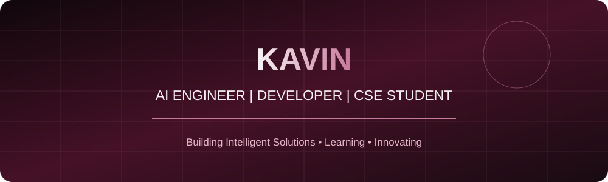

  

<h3>AI Engineer | Machine Learning Enthusiast | Full-Stack Developer</h3>

  <a href="https://github.com/Kavin-DR">GitHub</a> •
  <a href="https://github.com/Kavin-DR?tab=repositories">Projects</a>

---

## 👨‍💻 About Me

Hello! I'm **Kavin**, a passionate Computer Science and Engineering student interested in Artificial Intelligence, Machine Learning, and Software Development.

- 🎓 Pursuing B.E. Computer Science and Engineering at KIT.
- 🤖 Interested in Artificial Intelligence and Generative AI.
- 💻 Practicing Data Structures and Algorithms.
- 🌱 Learning Machine Learning, Deep Learning, and Full-Stack Development.
- 🚀 Building practical projects that solve real-world problems.
- 🎯 Aspiring AI Engineer.

---

## 🛠️ Technical Skills

**Programming Languages**

**Web Development**

**Database & Tools**

---

## 🚀 Featured Projects

### 🤖 AI Spam Mail Detector
An AI-based spam classification project designed to identify spam messages using machine learning and deep learning concepts.

**Technologies:** Python, Flask, React, TensorFlow.

### 🎮 Game Verse
A gaming website focused on exploring games and discovering game reviews.

**Technologies:** HTML, CSS, JavaScript.

[View Project](https://github.com/Kavin-DR/Game-Verse)

### 🧠 DecodeLabs Internship Projects
A collection of projects developed during my Artificial Intelligence internship.

**Technologies:** Python, AI, Machine Learning.

[View Repository](https://github.com/Kavin-DR/DecodeLabs-Internship)

---

## 🏆 Certifications

- Machine Learning Foundation Certification — Infosys.
- Fundamentals of Generative AI — NPTEL.
- Foundation of Cybersecurity — Coursera.
- Operating System Foundation — Coursera.
- Generative Models of AI — Infosys.
- MongoDB Basics for Students.

---

## 📊 GitHub Statistics

---

## 🔥 Contribution Activity

---

## 📈 Currently Focusing On

- Data Structures and Algorithms.
- Artificial Intelligence and Machine Learning.
- Generative AI applications.
- Full-Stack Development.
- Building innovative software projects.

---

### 💫 "Turning ideas into intelligent solutions."

